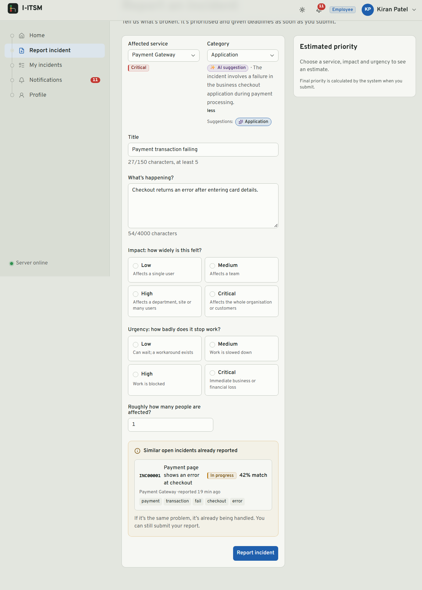
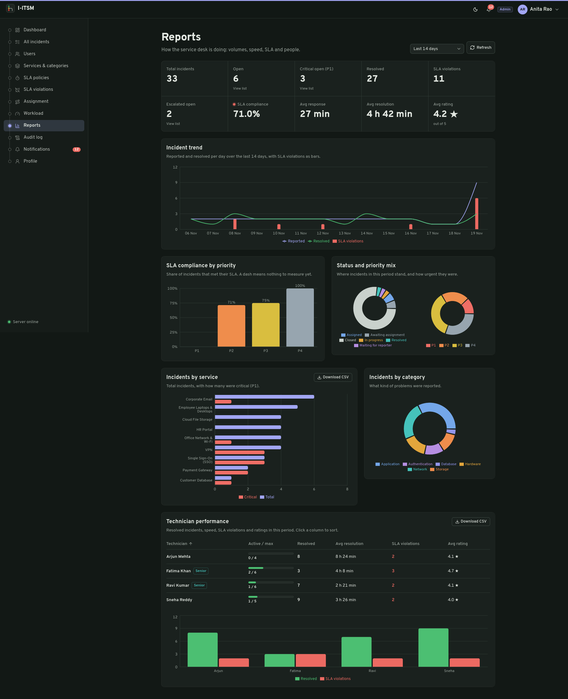
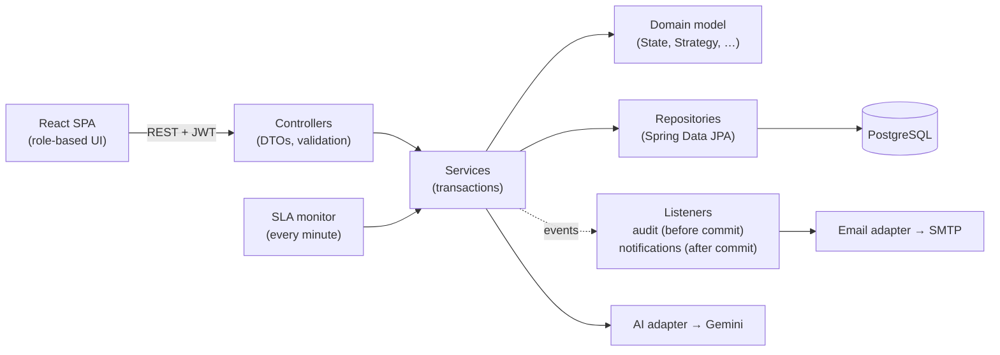

# I-ITSM: Intelligent IT Service Management & Incident Resolution System

A full-stack application that manages the complete lifecycle of IT incidents in an organisation:
**Report → Classify → Prioritize → Assign → Investigate → Resolve → Verify → Close**. It adds automatic
prioritisation, smart technician assignment, SLA monitoring with automatic escalation, duplicate detection,
AI-assisted categorisation, notifications, a full audit trail, and analytics dashboards.

Built for **CS F213 Object-Oriented Programming**, BITS Pilani Hyderabad Campus, Semester I 2026–27, as a
demonstration of object-oriented design in a real-world system.

> Team: **Group 69**: Vineet Singhal · Samarth Agrawal · Saket Kumar · Yatharth Shringi (see [Team](#team))

---

## Features
## Screenshots



**For employees**
- Report incidents with smart help:
  - **AI category suggestion** (Google Gemini) with a short reason, falling back to keyword matching;
  - a warning when **similar open incidents** already exist.
- Track their incidents with a live status and SLA countdown.
- Answer technician questions, add comments, and verify the fix with a 1–5 rating (or reopen the incident).
- In-app notifications (bell + inbox) and email notifications.

**For technicians**
- Assigned incidents: acknowledge, investigate, add work notes, request information, resolve.
- A "needs attention" list (at-risk, breached and escalated incidents), a personal workload page and an
  availability toggle.
- Link duplicate incidents.

**For administrators**
- Management of users, technicians (skills, limits, availability), IT services, categories (with keywords) and SLA
  policies.
- Three **assignment strategies**, switchable at runtime: `SKILL_BASED`, `LEAST_LOADED` and `SMART` (a weighted
  score with visible reasons). Plus auto-assign on report and ranked recommendations.
- Incident search with 11 filters, SLA violations, the audit log, and a **reports dashboard** (overview, SLA
  compliance, 14-day trends, technician performance, services, categories).

**Automation and intelligence**
- **Automatic priority:** `Impact × Urgency × Business criticality × affected-users factor` → P1–P4, with an
  explanation.
- **SLA tracking:** response and resolution deadlines per priority (with service-specific overrides), plus
  AT_RISK warnings at 75%.
- **Background SLA monitor:** runs every minute, records violations, and **escalates** unacknowledged P1/P2
  incidents to the technician, then senior technicians, then admins.
- **Duplicate detection:** text similarity (normalisation + Jaccard) with service and category bonuses.
- **Notifications:** an Observer design with in-app and email channels; email via SMTP (e.g. Mailtrap) or
  simulated in the console.
- **Immutable audit trail** of every incident event, written in the same transaction as the change.

## Tech stack

| Layer | Technologies |
|---|---|
| Backend | Java 21, Spring Boot 4.1.2 (Web MVC, Data JPA / Hibernate, Security, Validation, Mail, Scheduling), JWT (JJWT), BCrypt, Lombok, springdoc-openapi (Swagger UI) |
| Database | PostgreSQL (schema generated by Hibernate) |
| Frontend | React + Vite, React Router, Tailwind CSS, shadcn/ui, Axios, Recharts, lucide-react; light/dark mode |
| AI | Google Gemini API (behind an adapter, with automatic keyword fallback) |
| Testing | JUnit 5, AssertJ, Mockito, Spring MockMvc, spring-security-test: **133 automated tests** |

## Architecture



A layered monolith with a single-page frontend. Design patterns used include **State** (incident lifecycle),
**Strategy** (priority, assignment, notification channels), **Template Method**, **Observer** (domain events),
**Factory**, **Adapter** (email, AI), **Null Object**, **Repository**, **Specification**, **Registry** and **DTO**.

## Getting started

### Prerequisites
- **Java 21** or newer (JDK)
- **PostgreSQL** (tested with version 18)
- **Node.js** (LTS) and npm, for the frontend; see `frontend/README.md`
- Git. Maven is **not** required: the project includes the Maven wrapper (`mvnw`).

### 1. Clone

```bash
git clone https://github.com/Vinetix/OOP-ITSM-Project.git
cd OOP-ITSM-Project.git
```

### 2. Create the database

In pgAdmin or `psql`:

```sql
CREATE DATABASE itsm;
```

### 3. Configure the backend

Copy the template and fill in your own values:

```bash
cd backend/src/main/resources
cp application-local.properties.example application-local.properties     # Windows: copy …
```

Required settings in `application-local.properties`:

| Setting | Meaning |
|---|---|
| `spring.datasource.url` | e.g. `jdbc:postgresql://localhost:5432/itsm` |
| `spring.datasource.username` / `spring.datasource.password` | Your PostgreSQL user |
| `app.jwt.secret` | Any random string of **at least 32 characters** |

`application-local.properties` is git-ignored and imported automatically
(`spring.config.import=optional:classpath:application-local.properties`). **Never commit it.**

### 4. Run the backend

```bash
cd backend
./mvnw spring-boot:run          # Windows: .\mvnw spring-boot:run
```

Or run `com.itsm.ItsmApplication` from your IDE. The API starts on **http://localhost:8080**.
On first start, the tables are created and **demo data is seeded automatically**: users, the catalog, 8 demo
incidents across the lifecycle, and 24 historical incidents for the dashboards.

**API documentation (Swagger UI):** http://localhost:8080/swagger-ui.html

### 5. Run the frontend

```bash
cd frontend
npm install
npm run dev
```

Open **http://localhost:5173**. The backend URL is configured with `VITE_API_BASE_URL` (see
`frontend/.env.example` and `frontend/README.md`).

### Demo accounts

All demo accounts use the password **`Password@123`**.

| Role | Email |
|---|---|
| Administrator | `admin@itsm.com` |
| Technicians | `ravi.kumar@itsm.com`, `fatima.khan@itsm.com`, `sneha.reddy@itsm.com`, `arjun.mehta@itsm.com` |
| Employees | `rahul.verma@itsm.com`, `divya.nair@itsm.com`, `kiran.patel@itsm.com` |

### Optional: AI suggestions and real email

Both work out of the box in a fallback mode: keyword-based category suggestions, and emails printed to the
backend console. To enable the real services, add these to `application-local.properties`:

```properties
# AI category suggestion (Google Gemini). Get a free key at https://aistudio.google.com
app.ai.gemini.api-key=YOUR_KEY
# optional: app.ai.gemini.model, app.ai.gemini.fallback-models, app.ai.timeout-ms

# Real email, e.g. a Mailtrap sandbox (the free plan allows 1 email per 10 s)
spring.mail.host=sandbox.smtp.mailtrap.io
spring.mail.port=2525
spring.mail.username=YOUR_USERNAME
spring.mail.password=YOUR_PASSWORD
spring.mail.properties.mail.smtp.auth=true
spring.mail.properties.mail.smtp.starttls.enable=true
app.mail.min-interval-ms=10000
```

The startup log confirms the mode: `AI category suggestion: GEMINI (…)` / `OFF`, and
`Email notifications: SMTP` / `SIMULATED`.

## Running the tests

```bash
cd backend
./mvnw test                     # Windows: .\mvnw test
```

- **109 unit tests** need nothing else (no database).
- **24 integration tests** start the full application against a separate database. Create it once with
  `CREATE DATABASE itsm_test;`. They recreate its tables on every run and never touch `itsm`. Without it, they are
  skipped.

## Project structure

```
backend/
  src/main/java/com/itsm/
    security/      JWT authentication, login, registration
    user/          users (Employee, Technician, Admin), user management
    catalog/       services, categories, skills, SLA policies
    incident/      incident lifecycle (state/), priority/, sla/ (monitor, escalation),
                   assignment/ (strategies), events, search, duplicates
    intelligence/  duplicate detection, category suggestion, ai/ (Gemini adapter)
    notification/  in-app and email notifications (channels, email adapter)
    audit/         immutable audit trail
    report/        dashboards and analytics
    seed/          demo and historical data
    common/, config/
  src/test/java/   unit and integration tests
frontend/          React + Vite single-page application
docs/
  API_CONTRACT.md  REST API reference
```

## Team

| Member | Responsibilities |
|---|---|
| Vineet Singhal (2025A7PS0089H) | Team lead; incident core (lifecycle, priority, SLA, escalation, assignment), intelligence (duplicates, AI), integration |
| Samarth Agrawal (2025A7PS0383H) | Security (JWT, roles), users, service catalog, reports |
| Saket Kumar (2025A7PS0143H) | Frontend (React single-page application, all screens, dashboards, dark mode) |
| Yatharth Shringi (2025A7PS0056H) | Notifications, audit trail, demo data, automated tests, API documentation |

---

*Academic project for CS F213 (BITS Pilani Hyderabad Campus). Demo data is fictional.*
